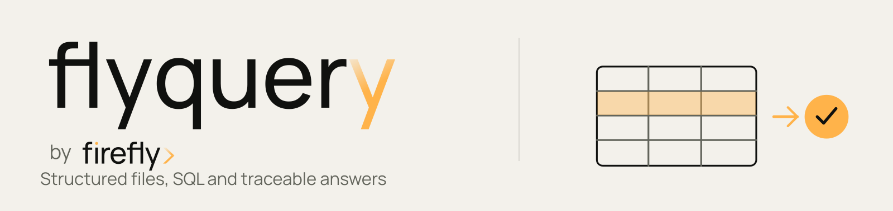

<div align="center">
<picture>
  <source media="(prefers-color-scheme: dark) and (max-width: 600px)" srcset="../../docs/assets/brand/banner-dark-mobile.svg">
  <source media="(max-width: 600px)" srcset="../../docs/assets/brand/banner-light-mobile.svg">
  <source media="(prefers-color-scheme: dark)" srcset="../../docs/assets/brand/banner-dark.svg">
  
</picture>

### Python SDK · asyncio · Python 3.9+
</div>

The Python SDK connects applications to [flyquery](https://github.com/fireflyframework/flyquery).
It includes generated API classes and Pydantic request/response models, plus
`FlyqueryClient` for uploads, questions, history and workspace setup. Installing
it does not install the flyquery server, pyfly or fireflyframework-agentic.

## Install

For the 26.10.3 release, install the wheel from GitHub Releases:

```bash
uv add https://github.com/fireflyframework/flyquery/releases/download/v26.10.3/flyquery_sdk-26.10.3-py3-none-any.whl
# Or, in an activated Python environment:
pip install https://github.com/fireflyframework/flyquery/releases/download/v26.10.3/flyquery_sdk-26.10.3-py3-none-any.whl
```

The source distribution is attached to the same
[release](https://github.com/fireflyframework/flyquery/releases/tag/v26.10.3).
The project publishes Python packages through GitHub Releases. For development,
run `uv pip install -e './sdks/python[dev]'` from the repository root.

Pin the SDK and service to the same release. The checked-in
[OpenAPI snapshot](../../openapi.json) describes the generated methods; review
release notes before changing either version.

## Connect to an existing workspace

For a bounded read-only agent integration, candidate 26.10.4 source also contains
`AgentReadClient`; it is not included in the published 26.10.3 wheel above.
It fixes a tenant/workspace/dataset scope and uses only the agent-token GET
routes. Its complete scope and bounds are described in the
[SDK guide](../../docs/sdks.md#bounded-agent-reads-in-candidate-26104).

```python
import os

from flyquery_sdk.agent_read_client import AgentReadClient


async def inspect_registered_tables() -> None:
    async with AgentReadClient(
        base_url=os.environ["FLYQUERY_URL"],
        tenant_id=os.environ["FLYQUERY_TENANT_ID"],
        workspace_id=os.environ["FLYQUERY_WORKSPACE_ID"],
        dataset_id=os.environ["FLYQUERY_DATASET_ID"],
        agent_token=os.environ["FLYQUERY_AGENT_TOKEN"],
    ) as client:
        page = await client.list_tables()
        for table in page.items:
            print(table.name)
```

Import the convenience client from `flyquery_sdk.client`. Supply the tenant
identifier and the workspace UUID assigned by your service administrator.
Dataset IDs are UUIDs too; names and slugs are used for lookup.

```python
import asyncio
import os

from flyquery_sdk.client import FlyqueryClient


async def main() -> None:
    async with FlyqueryClient(
        base_url=os.environ["FLYQUERY_URL"],
        tenant_id=os.environ["FLYQUERY_TENANT_ID"],
        workspace_id=os.environ["FLYQUERY_WORKSPACE_ID"],
    ) as fly:
        dataset = await fly.find_or_create_dataset(
            "orders", description="Synthetic order fixtures"
        )
        uploaded = await fly.upload(str(dataset.id), "examples/csv/sales_orders.csv")
        print(uploaded)
        answer = await fly.ask(str(dataset.id), "How many orders are there?")
        print(answer.sql, answer.preview, answer.explanation)


asyncio.run(main())
```

Uploads can invoke profiling, description and embedding services. Natural-language
questions invoke the configured model pipeline. Configure those providers before
running this example; provider charges depend on your deployment.

### Create a workspace, then bind its scope

An administrator can use an initial scope to create a workspace. Reopen the
client with the returned UUID before creating datasets in that workspace:

```python
async with FlyqueryClient(
    base_url=url, tenant_id=tenant_id, workspace_id=initial_workspace_id
) as setup:
    workspace = await setup.find_or_create_workspace("finance", name="Finance")

async with FlyqueryClient(
    base_url=url, tenant_id=tenant_id, workspace_id=str(workspace.id)
) as fly:
    dataset = await fly.find_or_create_dataset("orders")
```

Both lookup helpers create only after an HTTP 404. Authorization, transport and
server failures propagate. Concurrent creation can return HTTP 409; these helpers
do not provide a transactional exactly-once guarantee.

## Choose the API surface

| Task | Convenience method or generated class |
|---|---|
| Upload a file, directory or file list | `upload`, `upload_directory`, `upload_bulk` |
| Ask a question or a batch | `ask`, `ask_batch` |
| Read query history and results | `recent_queries`, `get_query`, `fetch_query_result` |
| Inspect statistics and billing | `workspace_stats`, `billing_rollup` |
| Manage schemas, relations and semantic definitions | Generated `SchemaObjectsApi`, `RelationsApi`, `SemanticMetricsApi` and related classes |
| Execute SQL without the model pipeline | Generated `SqlExecuteApi` |
| Call a scoped agent endpoint | Generated `AgentQueryApi`, `AgentSqlExecuteApi` and other `Agent*Api` classes |

Generated classes are exported from `flyquery_sdk.api`. They require explicit
context arguments even when `ApiClient` has default headers. Access a convenience
client's generated resources through `fly.workspaces`, `fly.datasets` or
`fly.query`; there is no public `fly.api_client` accessor.

```python
from flyquery_sdk import ApiClient, Configuration
from flyquery_sdk.api import WorkspacesApi

async with ApiClient(Configuration(host=url)) as api:
    page = await WorkspacesApi(api).list_workspaces(
        x_tenant_id=tenant_id,
        x_workspace_id=workspace_id,
        limit=20,
        _request_timeout=30.0,
    )
```

### Direct SQL

Direct SQL requires the workspace's `allow_direct_sql` setting. It queries tables
already registered for the dataset and bypasses natural-language generation.

```python
from uuid import UUID
from flyquery_sdk.api import SqlExecuteApi
from flyquery_sdk.models import SqlExecuteRequest

result = await SqlExecuteApi(api).execute(
    x_tenant_id=tenant_id,
    x_workspace_id=workspace_id,
    sql_execute_request=SqlExecuteRequest(
        dataset_id=UUID(dataset_id), sql="SELECT COUNT(*) AS total FROM orders"
    ),
    _request_timeout=30.0,
)
print(result)
```

A client timeout bounds how long the client waits. It does not provide an operating
system sandbox or prove that server execution has stopped.

## Authentication and agent routes

User routes carry `X-Tenant-Id` and `X-Workspace-Id`. These headers select scope;
they are not a substitute for deployment authentication. For bearer-protected
routes, set the generated client's Authorization header explicitly:

```python
async with ApiClient(Configuration(host=url)) as api:
    api.default_headers["Authorization"] = "Bearer " + os.environ["FLYQUERY_ACCESS_TOKEN"]
    # Call a generated resource with its explicit tenant/workspace parameters.
```

`Configuration.access_token` alone does not add a bearer header: the current
OpenAPI authentication schemes cover context headers and agent tokens. Read the
deployment's [security contract](../../docs/security-model.md).

Agent routes accept a separately issued `X-Agent-Token` with tenant, workspace
and permission claims. Read the token from your secret store or environment:

```python
from flyquery_sdk.api import AgentQueryApi
from flyquery_sdk.models import QueryRequest

answer = await AgentQueryApi(api).query(
    x_agent_token=os.environ["FLYQUERY_AGENT_TOKEN"],
    query_request=QueryRequest(dataset_id=UUID(dataset_id), question="How many orders?"),
    _request_timeout=30.0,
)
```

Passing `agent_token` to `FlyqueryClient` adds that header to its requests. Its
`ask` and upload helpers still call user routes; use the generated agent classes
when you need `/api/v1/agent/*`. Supply `idempotency_key` on mutating generated
calls when required by your integration.

## Files, batches and errors

`upload_bulk` returns one outcome per file. Check `result.results` and each item's
`status` and `error`; an HTTP success does not mean every file succeeded. The same
rule applies to `ask_batch` and its per-question results.

Generated calls and generated-backed convenience methods raise
`flyquery_sdk.exceptions.ApiException`. HTTPX-backed helpers such as `upload` and
`ask` raise `httpx.HTTPStatusError` for unsuccessful HTTP responses and
`httpx.RequestError` for transport failures. Pydantic validation errors indicate a
request or response that does not match the SDK model.

```python
import httpx
from flyquery_sdk.exceptions import ApiException

try:
    await fly.find_or_create_dataset("orders")
except ApiException as error:
    print(error.status, error.body)

try:
    await fly.ask(dataset_id, "How many orders?")
except httpx.HTTPStatusError as error:
    print(error.response.status_code, error.response.text)
```

`FlyqueryClient(timeout=120.0)` sets the timeout for its HTTPX helpers. Generated
calls accept `_request_timeout` per call. Use an async context manager to close
both connection pools. Sync helpers use `asyncio.run`; use async methods directly
inside notebooks or other hosts with a running event loop.

## Stream a response

Use `stream_without_preload_content` to retain the response body. The returned
value is the raw aiohttp `ClientResponse`:

```python
from flyquery_sdk.api import QueryApi

stream = await QueryApi(api).stream_without_preload_content(
    x_tenant_id=tenant_id,
    x_workspace_id=workspace_id,
    query_request=QueryRequest(dataset_id=UUID(dataset_id), question="Orders by region?"),
    _request_timeout=120.0,
)
try:
    stream.raise_for_status()
    async for line in stream.content:
        print(line.decode("utf-8").rstrip())
finally:
    stream.release()
```

Interpret the SSE frames described in the [query pipeline](../../docs/pipeline.md).
`stream_with_http_info` preloads the body and is not a streaming context manager.

## Develop and verify

```bash
cd sdks/python
uv venv
uv pip install -e '.[dev]'
uv run pytest -q tests
uv run ruff check flyquery_sdk/client.py tests examples
uv run ruff format --check flyquery_sdk/client.py tests examples
uv build
```

The test suite checks imports, typed responses and context/error handling over a
real loopback HTTP socket. Service integration tests are separate and require
PostgreSQL, Redis and the source-built MinIO test image. See the
[SDK overview](../../docs/sdks.md) and [example guide](examples/README.md).

Licensed under Apache 2.0. Copyright Firefly Software Foundation.
